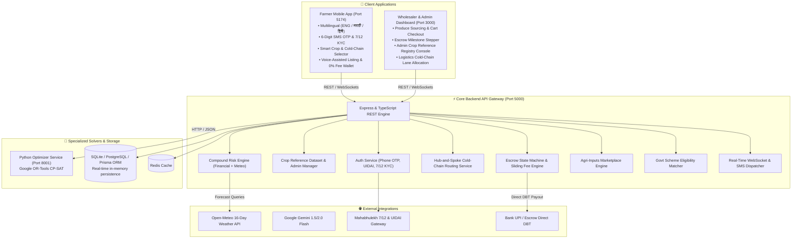

# 🌱 KhetSetu (खेतसेतु)

### Direct B2B AgTech Marketplace & Farm-Gate Logistics Hub

[](https://docs.npmjs.com/cli/using-npm/workspaces)
[](apps/api)
[](apps/optimizer)
[](apps/web-dashboard)
[](apps/farmer-mobile)
[](LICENSE)

---

## 📌 Mission & Overview

In traditional Indian agricultural supply chains, smallholder farmers lose **6% to 12%** of gross earnings to middlemen commissions, APMC cess, and opaque deductions, while facing extreme price volatility and cold-chain losses.

**KhetSetu** bridges rural village collection centers (Spokes) directly with urban wholesale aggregation centers (Hubs), delivering:

1. **Guaranteed 0% Platform Fee to Farmers**: Transparent sliding fees (1.8% – 3.5%) are charged solely to wholesale buyers; farmers receive **100%** of their agreed produce price through direct DBT escrow.
2. **Authorized Phone OTP Login & Trusted Farmer KYC**: Secure SMS OTP authentication with mandatory government verification (12-digit Aadhaar UIDAI, 7/12 Saat Bara land records, direct DBT bank details, PM-Kisan ID, and live photo).
3. **Smart Crop Reference & Cold-Chain Routing**: Real reference dataset covering major Indian crops, cascading variety options, automatic cold-chain detection, produce reference previews, and an admin-editable crop registry.
4. **Voice-Assisted & Manual Listing**: Vernacular voice listing with phonetic matching and automated variety / cold-chain detection.
5. **Milestone Escrow State Machine**: Buyer funds are securely locked in platform escrow before harvest pickup and released instantaneously upon quality verification at the destination hub.
6. **Compound Risk Scorecard**: Union formula scoring combining financial fragility and 16-day Open-Meteo weather forecasts.
7. **Relief & Budget Optimizer**: Integer programming microservice powered by **Google OR-Tools CP-SAT** to maximize disaster risk reduction under strict relief budget constraints.
8. **Government Scheme Matcher**: Automated eligibility matching and 1-click enrollment for 7 central and state schemes (PMFBY, KCC, PM-KISAN, etc.).
9. **Agri-Inputs Marketplace**: Verified seeds, organic fertilizers, and crop-protection inputs available directly for spoke-level delivery.

---

## 🌐 Running Application Links & Port Mapping

| Service | Port & Direct Link | Purpose | Default Credentials / Quick Access |
| :--- | :--- | :--- | :--- |
| **Farmer Mobile Web App** | [http://localhost:5174](http://localhost:5174) | Farm-Gate Farmer Portal | • English default (Marathi & Hindi toggles)<br>• **1-Click Demo**: *Ramesh Tukaram Patil*<br>• Real Phone Login + SMS OTP + 7/12 KYC |
| **B2B Web Dashboard** | [http://localhost:3000](http://localhost:3000) | Wholesaler & Admin Portal | • **Wholesaler**: `rahul.mehta@mumbaiagro.com`<br>• **Admin**: `admin@khetsetu.gov.in` |
| **Backend REST API** | [http://localhost:5000/api/v1/health](http://localhost:5000/api/v1/health) | REST API & WebSockets | Health check endpoint returning `{"status":"ok"}` |
| **OpenAPI / Swagger Docs** | [http://localhost:5000/api/docs/](http://localhost:5000/api/docs/) | Interactive API Documentation | Explore and execute all REST endpoints live |
| **Python Relief Optimizer** | [http://localhost:8001/docs](http://localhost:8001/docs) | CP-SAT Budget Solver | FastAPI Swagger interface for the OR-Tools solver |

---

## 🏛️ System Architecture



---

## 📂 Monorepo Structure

```text
khetsetu/
├── apps/
│   ├── api/                 # Express, TypeScript, Prisma ORM, WebSocket notification engine
│   │   ├── prisma/          # Prisma schema with CropReference, CropVariety, User, Profile
│   │   └── src/
│   │       ├── controllers/ # Crop reference, auth, listings, orders, inputs controllers
│   │       ├── database/    # Real-world seed data (Maharashtra crops, varieties, spokes)
│   │       ├── routes/      # Express API route mapping
│   │       └── services/    # Business logic (Escrow, Risk, Auth, CropRef, Logistics)
│   ├── farmer-mobile/       # React 18, Vite, Tailwind CSS mobile PWA (ENG / मराठी / हिंदी)
│   │   └── src/
│   │       ├── components/  # LoginModal (KYC/OTP), NewListingView, InputsStoreView, HomeView
│   │       └── types.ts     # Mobile TypeScript domain types
│   ├── optimizer/           # FastAPI, Google OR-Tools CP-SAT budget solver, pytest
│   │   ├── main.py          # Integer linear programming solver
│   │   └── requirements.txt # Python dependencies
│   └── web-dashboard/       # React 18, Vite, Tailwind CSS Wholesaler & Admin console
│       └── src/
│           └── components/  # AdminView, CropReferenceView, SourcingCatalog, MilestoneStepper
├── packages/
│   └── shared-types/        # Shared TypeScript domain interfaces, enums, fee tiers
├── docker-compose.yml       # Production orchestrator (Postgres, Redis, API, Optimizer, Web)
├── package.json             # Root npm workspaces configuration
└── tsconfig.json            # Shared TypeScript root configuration
```

---

## 📦 Key Functional Modules

### 1. Smart Crop Reference & Cold-Chain Routing

- **Comprehensive Agricultural Dataset**: Backed by `crop_reference` and `crop_varieties` models covering major Indian fruits, vegetables, grains, pulses, and spices.
- **Cascading Variety Population**: Selecting a crop immediately populates verified regional varieties (e.g. Tomato → Desi, Hybrid, Cherry; Wheat → Sharbati, Lokwan; Mango → Alphonso, Kesar, Dasheri).
- **Automated Cold-Chain Detection**: Automatically assigns `requires_cold_chain` flags based on crop perishability, enforcing temperature-controlled transport lanes during logistics dispatch.
- **Reference Previews**: Displays high-fidelity produce reference photography alongside farmer batch uploads.
- **Admin-Editable Console**: Administrators can add or edit crops, varieties, and perishability rules live via [http://localhost:3000](http://localhost:3000) without code redeployment.
- **Graceful Fallback**: Unrecognized regional crops seamlessly fall back to free-text entry and are flagged for admin review.

### 2. Farmer Authentication & Trusted KYC Onboarding

- **Default English Navigation**: The portal loads in English by default, with 1-click toggles for Marathi (मराठी) and Hindi (हिंदी).
- **1-Click Verified Demo**: Instant access as *Ramesh Tukaram Patil* (Niphad, Nashik • 6.5 Acres • 7/12 & Aadhaar Verified).
- **Carrier SMS OTP Dispatch**: Standardized +91 mobile authentication with monospace 6-digit PIN entry and 1-tap auto-fill.
- **Mandatory Trusted KYC Pipeline**:
  - **Aadhaar UIDAI**: 12-digit identity verification (`XXXX XXXX XXXX`) with encrypted upload.
  - **7/12 Saat Bara**: Gat / Survey number verification (Mahabhulekh land record).
  - **Direct DBT Bank Escrow**: Verified IFSC and account linkage ensuring 0% deduction payouts.
  - **Live Photo & PM-Kisan**: Farmer photo verification and registry linkage.

### 3. Escrow State Machine & 0% Farmer Commission

- **Guaranteed 0% Farmer Fee**: Farmers receive 100% of their listed produce price with zero deductions.
- **Sliding Buyer Platform Fee**:

  | Produce Amount | Buyer Fee |
  | :--- | :---: |
  | Below ₹25,000 | 3.5% |
  | ₹25,000 to ₹1,00,000 | 2.5% |
  | Above ₹1,00,000 | 1.8% |

- **Deterministic 6-Stage Milestone Lifecycle**:

  ```text
  ORDER_PLACED → ESCROW_FUNDED → PICKED_UP_AT_SPOKE → IN_TRANSIT → DELIVERED_TO_HUB → PAYOUT_RELEASED
  ```

### 4. Relief Budget Optimizer (Google OR-Tools CP-SAT)

Mathematical optimization formulated as a bounded 0-1 Knapsack / Generalized Assignment problem:

$$
\max \sum_{i \in \text{Farmers}} \sum_{j \in \text{Interventions}} \Delta R_{i,j} \cdot x_{i,j}
$$

subject to:

$$
\sum_{i} \sum_{j} c_j \cdot x_{i,j} \le \text{TotalBudget}, \qquad \sum_{j} x_{i,j} \le 1 \quad \forall i
$$

where $x_{i,j} \in \{0,1\}$ indicates whether farmer $i$ receives intervention $j$, $c_j$ is the cost of intervention $j$, and $\Delta R_{i,j}$ is the resulting risk reduction.

### 5. Compound Risk Scorecard

Calculates financial and climate vulnerability using the union probability formula:

$$
R_{\text{compound}} = 100 - \frac{(100 - R_{\text{financial}}) \times (100 - R_{\text{disaster}})}{100}
$$

---

## 🚀 Quickstart & Local Setup

### Prerequisites

- **Node.js**: v18.0.0 or higher (v20+ recommended)
- **npm**: v9.0.0 or higher
- **Python**: v3.10+ (optional, for the CP-SAT relief optimizer)

### 1. Clone & Install Dependencies

```bash
# Clone the repository
git clone https://github.com/your-org/khetsetu.git
cd khetsetu

# Install all monorepo dependencies
npm install

# (Optional) Install Python Optimizer dependencies
pip install -r apps/optimizer/requirements.txt
```

### 2. Build Monorepo Workspaces

```bash
npm run build
```

### 3. Start Development Servers

Run the full stack concurrently using npm workspace commands:

```bash
# Start Core Backend API (Port 5000)
npm run dev:api

# Start Wholesaler & Admin Web Dashboard (Port 3000)
npm run dev:web

# Start Farmer Mobile Web App (Port 5174)
npm run dev:mobile

# (Optional) Start Python Optimizer (Port 8001)
cd apps/optimizer && uvicorn main:app --port 8001 --reload
```

---

## 🧪 Running Tests

```bash
# Run backend unit and integration test suites
npm test

# Run crop reference & cold-chain integration tests
npm test --workspace=@khetsetu/api -- src/__tests__/crop_reference.test.ts

# Run Python Optimizer CP-SAT tests
pytest apps/optimizer
```

---

## 🐳 Docker Deployment

To launch the complete containerized stack:

```bash
docker-compose up --build
```

Exposed services:

- **Farmer Mobile App**: <http://localhost:5174>
- **Wholesaler Dashboard**: <http://localhost:3000>
- **API & Swagger Documentation**: <http://localhost:5000/api/docs>
- **Python CP-SAT Optimizer**: <http://localhost:8001/docs>
- **PostgreSQL Database**: `localhost:5432`
- **Redis Cache**: `localhost:6379`

---

## 🛡️ License

Distributed under the MIT License. See [LICENSE](LICENSE) for details.
